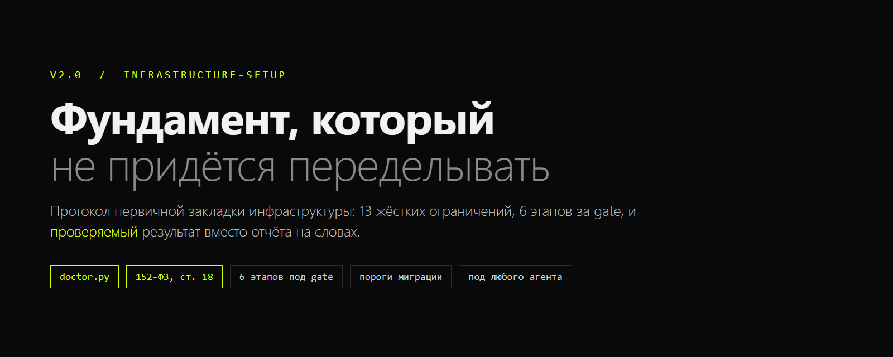
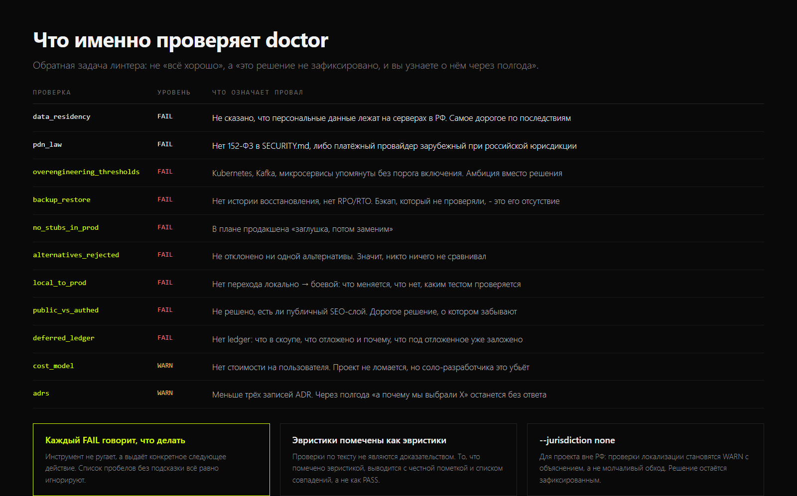

# Infrastructure Setup v2.0

**Протокол первичной закладки инфраструктуры приложения с проверяемым результатом.**



Одностраничный промт превращён в скилл: 13 жёстких ограничений, 6 этапов под
человеческий gate, комплект документации и **аудит покрытия**, который
показывает, какое решение не было принято, вместо того чтобы агент отчитался
словами.

Работает с любым агентом: Claude Code, Codex CLI, Cursor, Gemini CLI, Cline,
Aider, OpenCode: везде, где есть инструкция в текстовом файле и возможность
запустить Python.

```
git clone git@github.com:Samiixo/Infrastructure_skill.git
```

---

## Главная идея v2

v1 был один промт на 400 строк. Агент его выполнял и выдавал отчёт. Проблема
не в том, что агент плохой, а в том, что **отчёт нельзя проверить**: он мог
не упомянуть про локализацию персональных данных, и это обнаруживалось бы
через год, на этапе проверки РКН.

v2 добавляет обратную проверку. `tools/doctor.py` аудирует не код, а
**принятые решения** в документации, и падает на том, чего там нет:

```
$ python tools/doctor.py ./my-product

[FAIL] data_residency   Персональные данные: не зафиксировано, что хранилище
                        физически в РФ. ARCHITECTURE.md
                        -> Следующее действие: добавьте раздел о юрисдикции
                           хранения в ARCHITECTURE.md и продублируйте в
                           SECURITY.md
[FAIL] backup_restore   История восстановления не описана
                        -> Следующее действие: укажите RPO/RTO и дату
                           последней проверки восстановления
...
summary: 14 pass, 2 warn, 3 fail
```

Каждый FAIL говорит, что делать. Список пробелов без подсказки всё равно
игнорируют.

---

## 13 жёстких ограничений

Нарушение любого из них - FAIL, не WARN. Полный текст с юридической частью -
`references/constraints.md`.

1. **Мультиплатформенность** - один бэкенд на Web, iOS и Android
2. **Нагрузка** - 1000+ активных пользователей и путь до 100k без смены архитектуры
3. **Конкурентность** - race conditions, конфликты записи, идемпотентность
4. **Безопасность** - OWASP Top 10, модель auth, шифрование, секреты не в коде
5. **DDoS и злоупотребления** - rate limiting, WAF, защита от ботов и скрейпинга
6. **Скорость без техдолга** - системные решения с живым community
7. **Поддерживаемость** - слои, тестируемость, CI/CD с первого дня, IaC
8. **Без заглушек в проде** - порядок по зависимостям, не по удобству
9. **Данные только в РФ** - физическая юрисдикция дата-центра, не бренд софта
10. **Соло-разработчик** - managed вместо self-hosted, минимум технологий
11. **Локально -> MVP на РФ-сервере** - оба окружения описаны с самого начала
12. **Публичный SEO-слой отдельно от CSR** - или явное решение, что его нет
13. **Deferred не тащить в работу** - но общие контракты с первого дня

Пункт 9 стоит проговорить отдельно, потому что его регулярно понимают неверно.
152-ФЗ ст. 18 ч. 5 регулирует **физическое размещение дата-центра, а не бренд
софта**. Self-hosted MongoDB или PostgreSQL в российском облаке разрешены.
Их же зарубежные managed-версии (MongoDB Atlas, Supabase Cloud, Firebase) -
нет, потому что данные покидают РФ независимо от того, как это выглядит.
Практический порядок: сначала выбирается провайдер сервера в РФ, потом ПО под
него.

> Юридические ссылки проверены по состоянию на 2 сентября 2026 и не
> обновлялись машинно. Нормы меняются. **Перепроверьте с юристом.**

---

## Шесть этапов


| Этап | Что делаем |
|---|---|
| 1 | Название и позиционирование |
| 2 | Выбор стека с обоснованием по 13 слоям |
| 3 | Комплект из 8 документов |
| 4 | Брендбук |
| 5 | HTML/CSS/JS прототип |
| 6 | Roadmap API в порядке зависимостей |

Каждый этап закрывается **явным подтверждением человека**. Объединять этапы и
забегать вперёд нельзя. Приоритет при конфликте требований: качество и
архитектурная корректность важнее скорости. "Быстрый, но грязный" вариант не
предлагается по умолчанию - только как явно помеченная альтернатива.

Правило обоснования для каждого слоя стека:

> **Слой** / **Выбор** / **Почему именно она** (привязано к constraints) /
> **Рассмотренные альтернативы** (минимум 2, почему отклонены) /
> **Известные ограничения** (честно) / **Путь масштабирования** (x10, x100)

И правило, которое чаще всего нарушают: **любая сложность имеет письменный
порог включения.** "Kubernetes" без фразы "переходим при устойчивой нагрузке
от X RPS" - не решение, а амбиция.

---

## Что добавилось в 2026

Ограничения v1 писались до того, как часть вещей стала обязательной. Полный
список - `references/modern-reality.md`, коротко:

- **Бэкапы, RPO/RTO, PITR** - и дата последней проверки восстановления.
  Непроверенный бэкап - это отсутствие бэкапа.
- **Стоимость владения** - цена на одного активного пользователя в месяц и
  потолок расходов. Соло-разработчика убивает не сложность кода, а счёт.
- **OpenTelemetry** как стандарт трассировки вместо связки "логи + Sentry".
- **Terraform/OpenTofu** - прод, настроенный руками через SSH,
  не воспроизводится.
- **Progressive delivery** - feature flags, blue-green, миграции БД по схеме
  expand/contract вместо необратимого шага.
- **AI-слой**, если он есть: маршрутизация моделей, потолок стоимости на
  запрос, eval против регрессий качества, поведение при недоступности.
- **Модель данных** - UUID против автоинкремента, валюта в минорных единицах
  (никогда float), время в UTC. Всё это дешевле решить сразу.
- **Доступность** как ограничение архитектуры, а не задача на потом.

---

## Что именно проверяет doctor



Обратная задача линтера: не "всё хорошо", а "это решение не зафиксировано".

| Проверка | Уровень | Что означает провал |
|---|---|---|
| `data_residency` | FAIL | Не сказано, что ПД лежат в РФ. Самое дорогое |
| `pdn_law` | FAIL | Нет 152-ФЗ, либо платёжный провайдер зарубежный |
| `overengineering_thresholds` | FAIL | K8s/Kafka/микросервисы без порога включения |
| `backup_restore` | FAIL | Нет RPO/RTO и истории проверки |
| `no_stubs_in_prod` | FAIL | В плане прода «заглушка, потом заменим» |
| `alternatives_rejected` | FAIL | Не отклонено ни одной альтернативы |
| `local_to_prod` | FAIL | Нет описания перехода и тест-плана |
| `public_vs_authed` | FAIL | Не решено, есть ли публичный SEO-слой |
| `deferred_ledger` | FAIL | Нет ledger: скоуп / deferred / подготовлено |
| `cost_model` | WARN | Нет стоимости на пользователя |
| `adrs` | WARN | Меньше трёх записей ADR |

Для проекта вне РФ: `python tools/doctor.py . --jurisdiction none` - проверки
локализации становятся WARN с объяснением, а не молчавым обходом.

**Честно о методе:** проверки по тексту - эвристики, а не доказательство.
Всё, что помечено эвристикой, выводится с пометкой и списком совпадений, а не
как уверенный PASS. Доказать по тексту нельзя, можно только не дать пройти
молча.

### Что нашлось при проверке инструмента

Прогон по **незаполненному** проекту, а не только по правильному, вскрыл три
ложных PASS. Сопоставление ключевых слов разбивало границы только для
коротких слов и только по латинице, поэтому длинные русские основы
сравнивались как подстрока:

| Ключевое слово | Совпадало с | Что это давало |
|---|---|---|
| `руб` | `зарубежных` | `cost_model` показывал PASS |
| `месяц` | `месяцами работы` | `cost_model` показывал PASS |
| `каталог` | `каталогов` (дерево) | `public_vs_authed` показывал PASS |

То есть на пустом проекте, где ни одно решение не принято, инструмент
докладывал успех. Это ровно тот театр, против которого он и написан. Ключевые
слова сделаны однозначными (`рубл`, `руб.`, `в месяц`), а `каталог` убран как
слишком неоднозначный; на все три случая есть регрессия, и она проверена
мутацией: с возвращённым багом зуб краснеет, с исправлением зеленеет.

Отдельно: в этот README просочились символы псевдографики, которых нет в
cp1251. Правило про них действовало только для `.py`, а README был исключён из
проверки как русский текст. Теперь проверка покрывает и markdown.

---

## Быстрый старт

```bash
git clone git@github.com:Samiixo/Infrastructure_skill.git
cd Infrastructure_skill

# тесты самого протокола
python tests/run_selftest.py

# развернуть протокол в новый проект
python tools/install.py --target /path/to/project --dry-run
python tools/install.py --target /path/to/project

# проверить готовый проект
python tools/doctor.py /path/to/project

# матрица решений по слоям (без победителя)
python tools/stack_matrix.py
```

Требуется Python 3.9+, только стандартная библиотека.

### Как использовать

Скопируйте `SKILL.md` в проект как инструкцию агента (или отдайте
`references/` как контекст), заполните описание продукта и пройдите этапы под
gate. Подробный режим работы - в самом `SKILL.md`.

---

## Структура

```
Infrastructure_skill/
|-- SKILL.md                     ядро протокола
|-- references/
|   |-- constraints.md           13 ограничений + 152-ФЗ и смежное
|   |-- stage1-naming.md         ... stage6-roadmap.md
|   |-- modern-reality.md        что добавить в 2026
|   `-- doc-templates.md         скелеты 8 документов
|-- tools/
|   |-- doctor.py                аудит принятых решений
|   |-- stack_matrix.py          матрица решений по слоям
|   |-- guard_secrets.py         поиск секретов, значения маскируются
|   `-- install.py               установка протокола в проект
|-- templates/                   заготовки документов
|-- examples/                    пример заполненного вывода
|-- tests/run_selftest.py
`-- docs/PROMPT_v1_original.md   оригинал v1 для истории
```

---

## English summary

A protocol for an AI agent to design a product's infrastructure from zero:
13 hard constraints, 6 gated stages, an 8-document set, and - the actual v2.0
addition - **machine-verifiable output**.

v1 was a single 400-line prompt with no verification, so an agent could report
success while silently skipping the decision that mattered most. v2.0 ships
`tools/doctor.py`, which audits the decisions recorded in the documentation
rather than the code, and fails on what is missing: data residency, personal
data law, migration thresholds for any added complexity, backup and RPO/RTO,
the local-to-production transition, the public-vs-authenticated decision, and
the capability ledger. Every FAIL prints the next action, not just a complaint.

`tools/stack_matrix.py` deliberately does not pick a winner. It prints, per
mandatory layer, the candidates, the deciding question, and what evidence would
settle it - because the most common agent failure here is asserting a stack
choice with no comparison.

Legal references are Russian (152-FZ art. 18, art. 9, art. 12, art. 22,
436-FZ, 347-FZ) and were carried over from v1 **as of 2 September 2026**;
they are explicitly not auto-updated and must be re-verified with a qualified
lawyer. MIT licensed.

---

## Лицензия

MIT, `Copyright (c) 2026 Samiixo`. Протокол написан автором репозитория.
Полный список изменений относительно v1 - в `CHANGELOG.md`, происхождение
идей - в `NOTICE.md`.
